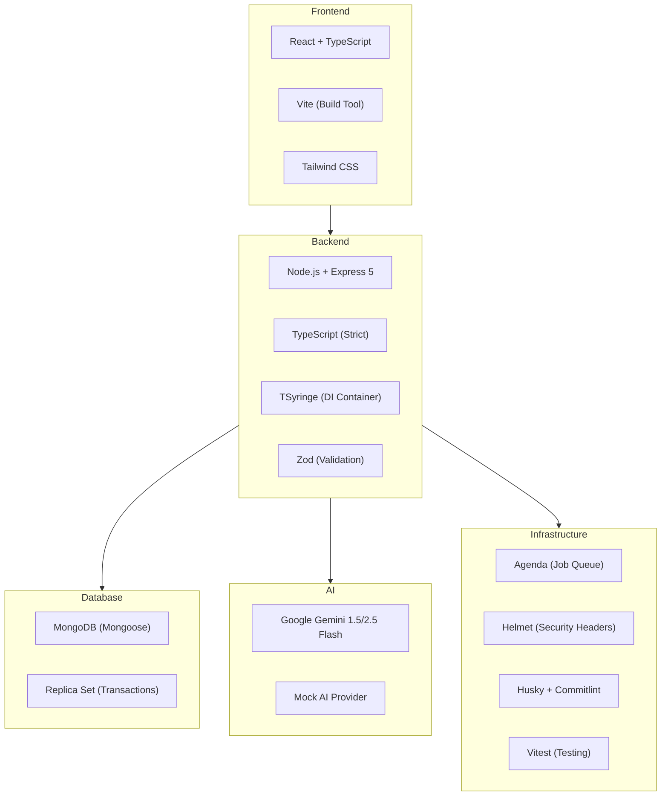
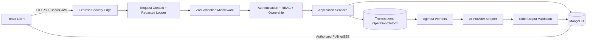
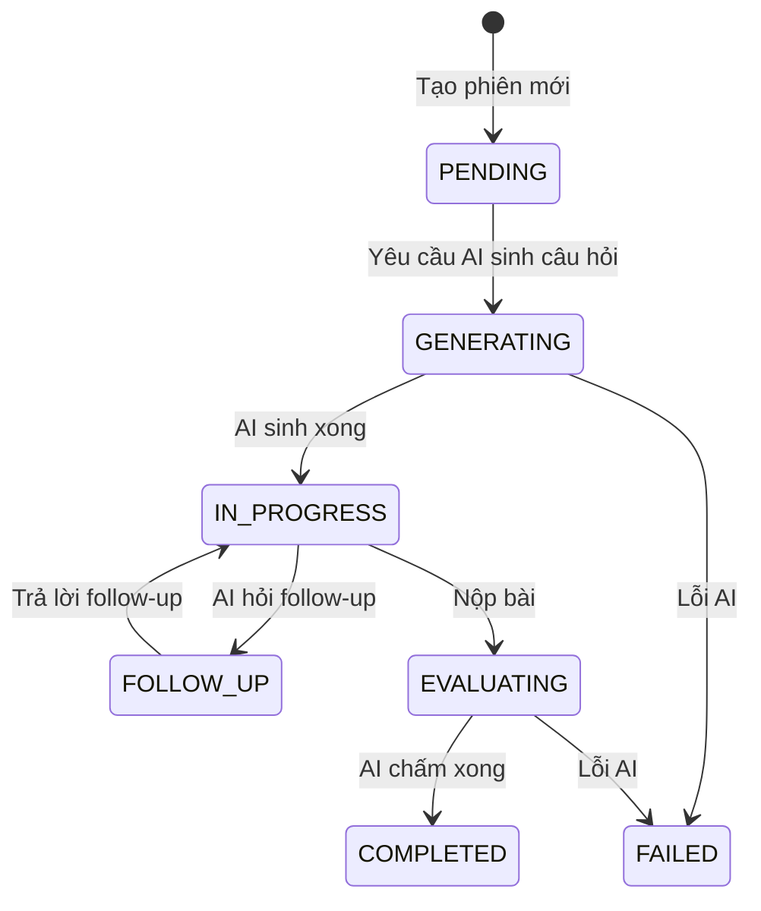
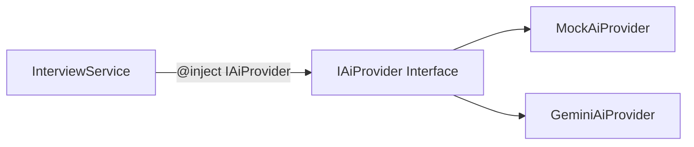
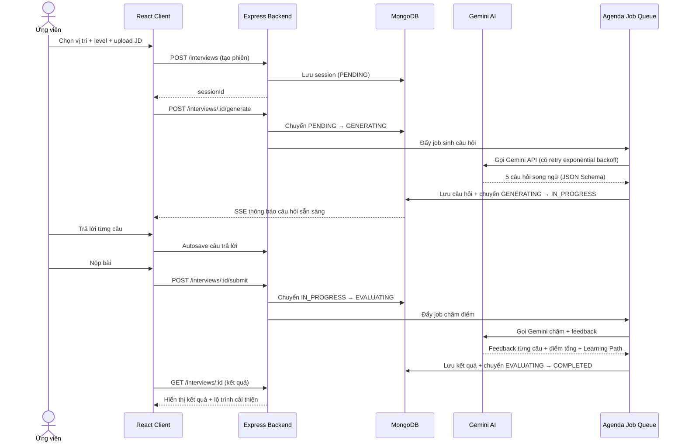

# 📋 Tổng Quan Dự Án: VTI Intern Practice IT Interviews with AI

> **Tài liệu này tổng hợp toàn bộ nghiệp vụ, kiến trúc và cách làm dự án để phục vụ buổi bảo vệ.**

---

## 1. Mục Tiêu & Bài Toán Nghiệp Vụ

### Bài toán
Ứng viên IT (fresher/junior/senior) cần luyện tập phỏng vấn nhưng thiếu môi trường thực hành. Dự án xây dựng **hệ thống phỏng vấn giả lập bằng AI** — AI đóng vai người phỏng vấn, tự động sinh câu hỏi, nhận diện câu trả lời, chấm điểm, và gợi ý lộ trình cải thiện.

### Đối tượng sử dụng
| Vai trò | Quyền hạn |
|---|---|
| **Candidate** (Ứng viên) | Đăng ký, đăng nhập, tạo phiên phỏng vấn, trả lời, xem kết quả, xem lịch sử, xem thư viện câu hỏi |
| **Admin** | Quản lý người dùng (lock/unlock), quản lý taxonomy (role, level, technology), quản lý System Prompt, quản lý Question Bank, xem metrics |

### 4 chức năng chính
1. **Quản lý người dùng**: Đăng ký, đăng nhập (email + Google OAuth), hồ sơ cá nhân, đổi mật khẩu, quên mật khẩu (OTP qua email)
2. **Ngân hàng câu hỏi (Question Bank)**: Theo vị trí IT, cấp độ kinh nghiệm, taxonomy đa chiều, versioned snapshots, AI translation, semantic duplicate detection
3. **Phỏng vấn AI**: AI sinh câu hỏi song ngữ (Anh/Việt), ứng viên trả lời qua text, AI chấm điểm real-time qua SSE
4. **Báo cáo & đánh giá**: Phân tích kỹ năng, điểm mạnh/yếu, feedback từng câu, gợi ý lộ trình học tập (Learning Path)

---

## 2. Công Nghệ Sử Dụng (Tech Stack)



| Layer | Công nghệ | Lý do chọn |
|---|---|---|
| Frontend | React, Vite, TypeScript, Tailwind CSS | SPA nhanh, type-safe, HMR tốc độ cao |
| Backend | Node.js, Express 5, TypeScript strict | Giảm learning curve, tăng tốc MVP (ADR-002) |
| Database | MongoDB + Mongoose | Schema linh hoạt cho dữ liệu phi cấu trúc (câu hỏi AI, log hội thoại) (ADR-001) |
| AI | Google Gemini API | JSON Output Schema chuẩn, cost-effective |
| Job Queue | Agenda | Background job cho AI generation/evaluation |
| DI | TSyringe | Dependency Injection tự động qua decorator |
| Validation | Zod | Schema validation runtime, type inference |
| Testing | Vitest, Supertest, MongoDB Memory Server | Fast, ESM-compatible, in-memory DB cho test |

---

## 3. Kiến Trúc Hệ Thống

### 3.1 Mô hình tổng thể: Client-Server, Layered Architecture



### 3.2 Backend 3-Layer Architecture

```
src/
├── controllers/     ← Nhận HTTP Request, trả Response (14 controllers)
├── services/        ← Logic nghiệp vụ (22 services + AI providers)
├── repositories/    ← Thao tác Database (19 repositories)
├── models/          ← Mongoose Schema/Model (31 models)
├── domain/          ← Domain logic (State Machine, Question Bank rules)
├── middlewares/     ← Auth, RBAC, Rate Limit, Validation... (14 middlewares)
├── routes/          ← Express route definitions (12 route files)
├── infrastructure/  ← Events, Jobs, Logging, WebSocket
├── config/          ← DI container, Environment, Database
├── validators/      ← Zod schemas
└── types/           ← TypeScript interfaces
```

### 3.3 Frontend Structure

```
client/src/
├── pages/           ← 22 page components (Login, Register, Interview, Result, History, Admin...)
├── features/        ← 11 feature modules (InterviewRoom, QuestionBank, Auth, Admin...)
├── services/        ← API service layer
├── auth/            ← Auth context/hooks
├── design-system/   ← Reusable UI components
├── layouts/         ← Page layouts
└── locales/         ← i18n (song ngữ)
```

---

## 4. Design Patterns Đã Áp Dụng

### 4.1 State Pattern — Quản lý vòng đời phỏng vấn

Đây là **pattern quan trọng nhất** của dự án. Thay vì dùng `if/else` hoặc `switch/case` kiểm tra trạng thái, hệ thống dùng State Machine:



**7 State classes** trong [states/](file:///c:/Users/Duong Vinh/VTI_Intern_Practice_IT_Interviews_with_AI/src/domain/interview/states):
- `PendingState` → `GeneratingState` → `InProgressState` → `EvaluatingState` → `CompletedState`
- `FollowUpState` (AI hỏi câu bổ sung)
- `FailedState` (xử lý lỗi)

**Lợi ích**:
- **Open/Closed**: Thêm trạng thái `PAUSED` chỉ cần tạo class mới, không sửa code cũ
- **Chống spam/F5**: Request gọi sai trạng thái bị chặn ngay (`InvalidStateTransitionException`)
- **Liskov Substitution**: Mọi state thay thế nhau qua interface `IInterviewState`

### 4.2 Strategy Pattern — AI Provider



- **MockAiProvider**: Sinh mock data, chấm điểm ngẫu nhiên — dùng cho test/dev, không tốn API cost
- **GeminiAiProvider**: Tích hợp Gemini 1.5 Flash, JSON Output Schema, sinh 5 câu hỏi song ngữ
- Chuyển đổi provider qua `.env`, **không sửa 1 dòng code nào trong Service**

### 4.3 Dependency Injection (TSyringe)

```typescript
// InterviewService không biết gì về DB hay AI cụ thể
@injectable()
class InterviewService {
  constructor(
    @inject('IInterviewRepository') private repo: IInterviewRepository,
    @inject('IAiProvider') private ai: IAiProvider
  ) {}
}
```

**Lợi ích**: Dễ swap database (Mongoose → Prisma), swap AI (Gemini → OpenAI), dễ mock trong test.

### 4.4 Repository Pattern

Mọi thao tác DB qua interface → concrete implementation. Service không gọi trực tiếp Mongoose.

---

## 5. Tuân Thủ S.O.L.I.D

| Nguyên tắc | Cách áp dụng |
|---|---|
| **S** - Single Responsibility | Controller chỉ lo HTTP. Service chỉ lo business logic. Repository chỉ lo DB. Mỗi State class chỉ xử lý hành vi trong trạng thái đó. |
| **O** - Open/Closed | State Pattern: thêm state mới = tạo class mới, không sửa Context/Service. Strategy Pattern: thêm AI provider mới = tạo class mới. |
| **L** - Liskov Substitution | Mọi state thay thế nhau qua `IInterviewState`. State không hỗ trợ action → ném `InvalidStateTransitionException` đúng contract. |
| **I** - Interface Segregation | `IInterviewRepository` chỉ chứa `create`, `findById`, `updateStatus`, `update`. Không ép implement hàm không cần. |
| **D** - Dependency Inversion | Service phụ thuộc interface, không phụ thuộc concrete class. DI container (TSyringe) tự động inject qua constructor. |

---

## 6. API Endpoints Chính

### Authentication & Profile
| Method | Endpoint | Mô tả |
|---|---|---|
| POST | `/api/v1/auth/register` | Đăng ký |
| POST | `/api/v1/auth/login` | Đăng nhập (JWT access + refresh) |
| POST | `/api/v1/auth/google` | Đăng nhập Google OAuth |
| POST | `/api/v1/auth/refresh` | Refresh token |
| POST | `/api/v1/auth/forgot-password` | Gửi OTP qua email |
| POST | `/api/v1/auth/reset-password` | Reset password bằng OTP |
| GET | `/api/v1/profile` | Xem profile |
| PUT | `/api/v1/profile` | Cập nhật profile |

### Interview (Core Flow)
| Method | Endpoint | Mô tả |
|---|---|---|
| POST | `/api/v1/interviews` | Tạo phiên phỏng vấn mới |
| GET | `/api/v1/interviews/:id` | Lấy trạng thái hiện hành (chống F5) |
| POST | `/api/v1/interviews/:id/generate` | AI sinh câu hỏi (PENDING → GENERATING) |
| POST | `/api/v1/interviews/:id/submit` | Nộp bài chấm điểm (IN_PROGRESS → EVALUATING) |

### Admin
| Method | Endpoint | Mô tả |
|---|---|---|
| GET | `/api/v1/admin/metrics` | Dashboard thống kê |
| GET/PUT | `/api/v1/admin/users` | Quản lý user (lock/unlock) |
| CRUD | `/api/v1/admin/prompts` | Quản lý System Prompt |
| CRUD | `/api/v1/admin/question-bank` | Quản lý Question Bank |

### Question Library (Public)
| Method | Endpoint | Mô tả |
|---|---|---|
| GET | `/api/v1/questions/public` | Thư viện câu hỏi cho user tự học |

---

## 7. Luồng Nghiệp Vụ Chính — Phiên Phỏng Vấn



---

## 8. Bảo Mật (Security)

### 8.1 Các tầng bảo vệ
1. **Helmet** — Security HTTP headers
2. **CORS** — Allowlist origins (không dùng `*` trong production)
3. **JWT** — Access token (15 phút) + Refresh token (7 ngày), 3 secret riêng biệt (access, refresh, password-reset)
4. **RBAC** — Role-Based Access Control (Candidate/Admin), middleware kiểm tra route
5. **Ownership** — Mọi query phải có predicate `userId`, không nhận `userId` từ client
6. **Zod Validation** — Validate mọi request body/query/params
7. **Rate Limiting** — Chống brute force (login, register, AI calls, submit)
8. **Idempotency** — Idempotency-Key + Operation Record, chống double submit
9. **Audit Trail** — Ghi log mọi mutation đặc quyền, transaction với business write
10. **Log Redaction** — SHA-256 hash actor ID, không log token/password/PII/prompt/answer

### 8.2 Data Retention Policy
- Upload file gốc: chỉ trong memory, buffer overwrite ngay sau xử lý
- JD text: xóa sau 30 ngày khi session kết thúc
- Interview records: xóa sau 365 ngày
- Logs: 30 ngày, audit: 365 ngày
- Retention mutation fail-closed, cần approval Product/Legal

### 8.3 AI Security
- Prompt injection protection: tách `TRUSTED_SYSTEM_INSTRUCTION` và `UNTRUSTED_USER_CONTENT`
- Output validation: Zod + semantic validation trước khi persist
- Provider transport data: không persist, không log
- Retry chỉ các lỗi retryable (429, 503), exponential backoff

---

## 9. Question Bank — Hệ Thống Ngân Hàng Câu Hỏi

Hệ thống Question Bank được phát triển qua **7 phase** (AIP-62 → AIP-68):

| Phase | Nội dung |
|---|---|
| Phase 1 | Domain model, CRUD API, Admin UI baseline |
| Phase 2 | Governance: Four-eyes review, publish workflow |
| Phase 3 | Advanced: CSV import/export, bulk operations |
| Phase 4 | AI Translation, Embeddings, Semantic Duplicate Detection |
| Phase 5 | Safe Interview Integration (hybrid question source) |
| Phase 6 | Release Qualification (benchmark, contract tests) |
| Phase 7 | Production Rollout (feature flags, canary, monitoring) |

**Tính năng nổi bật**:
- Versioned question snapshots (ADR: giữ lịch sử thay đổi)
- Taxonomy đa chiều (technology, level, role)
- AI translation song ngữ
- Semantic duplicate detection bằng text embeddings
- Feature flags cho rollout an toàn

---

## 10. Quy Trình Phát Triển (Development Process)

### 10.1 Git Workflow
- **Branch naming**: `feature/AIP-XX-mô-tả`, `bugfix/...`, `hotfix/...`
- **Commit**: Conventional Commits (`feat:`, `fix:`, `docs:`, `refactor:`, `test:`)
- **Husky** tự động validate branch name + commit message
- **Lint-staged** chạy ESLint trước commit

### 10.2 Definition of Done (DoD)
Mỗi task chỉ "Done" khi:
- ✅ Code implement + tuân thủ coding standards
- ✅ TypeScript build pass (`tsc --noEmit`)
- ✅ ESLint pass
- ✅ Unit Test (coverage > 70%, core modules > 85%)
- ✅ API cập nhật Swagger/Postman
- ✅ Pull Request + code review
- ✅ CI build + test pass
- ✅ Test trên Staging/Dev

### 10.3 Testing Strategy
- **61 test files** backend (unit + integration + contract + performance + security)
- **Vitest** + **Supertest** + **MongoDB Memory Server** (in-memory DB)
- Test coverage tối thiểu 70%, module quan trọng 85%
- Contract test đối chiếu OpenAPI spec
- Security tests: RBAC, ownership, anti-leak, redaction
- Concurrency/race condition tests

---

## 11. Các Tính Năng Nâng Cao

| Tính năng | Mô tả |
|---|---|
| **Multi-Agent Evaluation** | Nhiều AI agent đánh giá song song |
| **Follow-up Questions** | AI hỏi câu bổ sung dựa trên câu trả lời |
| **Conversational Interview** | Phỏng vấn dạng hội thoại |
| **Whiteboard/Vision** | Hỗ trợ vẽ whiteboard, nhận diện hình ảnh |
| **Code Sandbox** | Chạy code trực tiếp trong phiên phỏng vấn |
| **Live Audio Stream** | Streaming audio |
| **Interview Analytics** | Phân tích xu hướng, thống kê |
| **Interview History** | Lịch sử phỏng vấn đầy đủ |
| **Interview Quota** | Giới hạn số phiên/ngày (5/ngày mặc định) |
| **Google OAuth** | Đăng nhập bằng Google |
| **Email OTP** | Khôi phục mật khẩu qua OTP email |
| **Study Library** | Thư viện câu hỏi public cho ứng viên tự học |

---

## 12. Kiến Trúc Quyết Định (ADR)

| ADR | Quyết định | Lý do |
|---|---|---|
| ADR-001 | MongoDB làm DB chính | Dữ liệu phi cấu trúc (câu hỏi AI, log hội thoại), schema thay đổi liên tục |
| ADR-002 | Express thay vì NestJS | Giảm độ phức tạp learning curve cho team, tăng tốc phát triển MVP |
| ADR Question Bank | Versioned Question Snapshots | Giữ lịch sử thay đổi câu hỏi, không mất data khi edit |

---

## 13. Tóm Tắt Điểm Nổi Bật Cho Bảo Vệ

> [!IMPORTANT]
> ### 🎯 Những điểm mạnh cần nhấn mạnh khi bảo vệ:

1. **Kiến trúc chuyên nghiệp**: Layered Architecture + SOLID + Design Patterns (State, Strategy, Repository, DI) — không phải code "gộp chung" như sinh viên thường làm
2. **State Machine**: Giải quyết triệt để vấn đề chống spam, F5, double-submit — bài toán thực tế mà nhiều hệ thống production gặp
3. **AI Integration**: Không chỉ gọi API đơn giản mà có retry logic, output validation, prompt security, mock provider cho testing
4. **Security-first**: JWT triple-secret, RBAC, ownership check, rate limiting, audit trail, log redaction, data retention — tuân thủ security best practices thực tế
5. **Testing nghiêm túc**: 61 test files, coverage > 70%, contract tests, security tests, concurrency tests — chứng minh code chạy đúng bằng bằng chứng
6. **Question Bank hệ thống**: 7 phases phát triển, versioned snapshots, AI translation, semantic duplicates — không phải CRUD đơn giản
7. **DevOps chuẩn**: Conventional Commits, Husky, Lint-staged, CI pipeline — quy trình làm việc nhóm chuyên nghiệp

---

## 14. Câu Hỏi Thường Gặp Khi Bảo Vệ

### "Tại sao dùng MongoDB mà không dùng MySQL/PostgreSQL?"
→ Dữ liệu câu hỏi AI, log hội thoại, feedback có cấu trúc linh hoạt, thay đổi liên tục. MongoDB schema-less phù hợp hơn quan hệ cứng. Dùng Mongoose để vẫn có type-safety và validation.

### "Tại sao dùng Express mà không dùng NestJS?"
→ Team intern, cần giảm learning curve tối đa. Express + TSyringe đã có đủ DI, layered architecture. NestJS overkill cho MVP.

### "State Pattern có thực sự cần thiết không?"
→ Có. Không dùng State Pattern → phải viết `if (status === 'PENDING')` rải rác khắp code. Khi thêm trạng thái mới phải sửa nhiều nơi, dễ bỏ sót, vi phạm Open/Closed. State Pattern đóng gói hành vi, mở rộng không cần sửa code cũ.

### "Làm sao chống được người dùng spam request?"
→ 3 tầng: (1) State Machine chặn request sai trạng thái, (2) Rate Limiting giới hạn số request/thời gian, (3) Idempotency Key đảm bảo 1 logical operation chỉ tạo 1 effect.

### "AI sinh câu hỏi như thế nào?"
→ Gọi Gemini API với JSON Output Schema bắt buộc, đảm bảo output đúng cấu trúc. Có exponential backoff khi bị rate limit (429). Output qua Zod validation trước khi lưu DB. Có MockAiProvider để test không tốn API cost.

### "Bảo mật được xử lý thế nào?"
→ Defense in depth: Helmet (headers) → CORS (origins) → Auth middleware (JWT) → RBAC (role check) → Ownership (user check) → Zod (input validation) → Transaction (data integrity) → Audit (traceability) → Log redaction (PII protection).
